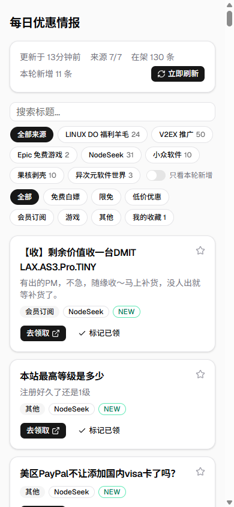

这次从零做了一个叫「每日优惠情报」的小站（`E:\agents\herdr\daily-discount`）：服务端每 2 小时自动抓 7 个优惠信息源，只保留近 7 天的条目、按原文链接去重，前端是移动端优先的单列卡片流，支持已领取/收藏持久化。需求来自一份写得很细的规格文件 `file.md`，做完后实测 7/7 源全部跑通，首轮入库 119 条。这里记录完整过程。

# 1. 先实测数据源，再谈架构

规格里列了 7 个源，写码之前我先把每个都 curl 了一遍，拿到真实返回格式，这一步直接决定了解析层怎么写：

| 源 | 实际格式 | 要点 |
| --- | --- | --- |
| LINUX DO 福利羊毛 | Jina 阅读器返回的 Markdown | `### [标题](url)` + url 重复行 + RFC 822 日期行，无正文摘要 |
| V2EX 推广 | **Atom**（不是 RSS） | entry 的 link 带 `#reply0` 后缀，content 是 CDATA HTML |
| Epic 免费游戏 | JSON API | `data.Catalog.searchStore.elements[]`，需过滤「当前生效且 100% 折扣」的 offer |
| NodeSeek | RSS 2.0 | 是全站 feed，不只有优惠帖，噪声靠分类规则兜底 |
| 小众软件 / 果核剥壳 | RSS 2.0 | 标准 feed |
| 异次元软件世界 | RSS 2.0 | 裸地址 301 跳到 `feed.iplaysoft.com`，fetch 默认跟随即可 |

Epic 那个接口有个细节：`elements` 里混着当前免费和下周预告，要看 `promotions.promotionalOffers[].promotionalOffers[]` 里有没有 `discountPercentage === 0` 且 `startDate <= now < endDate` 的 offer；链接 slug 按 `productSlug || urlSlug || catalogNs.mappings[0].pageSlug` 优先级取。实测返回里还真有一条 slug 是内部 hash 的（「浮游世界」），链接能用但不是可读名，属于可接受的边缘情况。

# 2. 技术选型

| 选择 | 理由 |
| --- | --- |
| 单进程 Express + 静态托管 Vite 产物 | 内部工具型应用：定时任务 + 几个 JSON API + 一个页面，不需要 Next.js/SSR |
| `node:sqlite`（Node 内置） | Node 26 实测可用，零依赖；规避 `better-sqlite3` 在 Windows 新 Node 版本上预编译二进制缺失、要拉 MSVC 编译链的风险 |
| `rss-parser` | 一个依赖同时吃 RSS 2.0（4 个源）和 Atom（V2EX） |
| `setInterval` 而非 node-cron | 「每 2 小时」用 setInterval + 启动即跑就够，少一个依赖 |
| React + TS + Tailwind v4 + shadcn/ui | 规格指定 shadcn 风格，官方原生栈还原最快 |
| 手动刷新 = 异步 + 轮询 | `POST /api/refresh` 立即返回，前端轮询 `/api/status` 到 `refreshing=false`。Jina 偶尔慢，阻塞式请求有超时风险 |
| 已领/收藏存服务端 SQLite | 规格要求持久化，已是带库的全栈应用，存服务端还多端一致，没必要用 localStorage |

> 💡 **通俗理解**：整个后端就是一个「报刊订阅员」——每 2 小时去 7 个报刊亭转一圈（`Promise.allSettled` 并发，哪家关门也不影响别家），新报纸登记入册（`url UNIQUE` 去重 + `is_new` 标记），超过 7 天的旧报纸直接扔掉。

# 3. 后端实现

## 3.1 表结构

两张表，`items` 存条目、`source_status` 存每源最近一次抓取结果：

```sql title="server/db.js 建表"
items(id, source, title, url UNIQUE, summary, category,
      published_at, expires_at, first_seen_at,
      is_new, claimed, favorited)
source_status(source PK, ran_at, ok, item_count, error)
```

`claimed`/`favorited` 直接放在 `items` 上——条目超 7 天本来就要删，状态跟着消失是合理行为，不用单独建用户态表。

## 3.2 抓取轮次 runRound

每一轮的编排逻辑：

1. 互斥锁检查（手动刷新撞上进行中的定时轮次直接拒绝）
2. `UPDATE items SET is_new = 0` 清掉上一轮的「本轮新增」标记
3. `Promise.allSettled` 并发抓 7 源，单源 `try/catch`，失败的源只记 `source_status` 不拖垮整轮
4. 逐条目 upsert：`url` 已存在则更新 title/summary/expires，不存在才 INSERT 且 `is_new=1`
5. 写每个源的成功条数或错误原因
6. 清理 `COALESCE(published_at, first_seen_at) < now-7d` 的旧条目

```js title="server/round.js 入库段"
for (const raw of r.value) {
  const item = { expires_at: null, source: name, ...raw };
  if (isOlderThan7d(item)) continue;
  item.category = raw.category ?? classify(raw.title);
  upsertItem(db, item);
  kept++;
}
recordSourceStatus(db, name, true, kept, null);
```

## 3.3 三个抓取器

- **LINUX DO**：拉 Jina 地址拿 Markdown，按 `### [标题](url)` 正则切块，往块内下几行找第一条匹配 RFC 822 格式的日期行。规格说「第三行是日期」，但按格式特征扫比数行号稳。
- **Epic**：fetch JSON 走上面说的 offer 过滤逻辑，强制 `category: '游戏'`，到期日取 offer `endDate`。
- **其余 5 个**：同一个 `rssSource(name, url)` 工厂函数实例化，`rss-parser` 解析，简介取 `contentSnippet` 或 strip HTML 后截 140 字。

分类是入库时对标题跑关键词规则（顺序即优先级）：游戏（Epic/游戏/喜加一/Steam）→ 会员订阅（会员/订阅/Pro）→ 限免 → 免费白嫖（免费领取/白嫖）→ 低价优惠（折扣/优惠码/大促/降价）→ 兜底「其他」。

## 3.4 API

| 端点 | 用途 |
| --- | --- |
| `GET /api/status` | 顶部统计：更新时间、refreshing、在架数、本轮新增数、每源 ok/count/error |
| `GET /api/items` | 全部在架条目，搜索和筛选全在前端内存做 |
| `POST /api/refresh` | 触发一轮，立即返回；进行中返回 `{already:true}` |
| `PATCH /api/items/:id` | `{ claimed?, favorited? }` 置位 |

# 4. 前端实现

Vite + React 19 + Tailwind v4，`npx shadcn init` 之后加了 button/badge/card/input/switch 五个组件，页面拆成 `StatsBar`（统计条+刷新按钮）、`FilterChips`（搜索框+来源/类别 chips+只看新增开关）、`DealCard`（优惠卡片）三块，状态都在 `App.tsx` 里用 useState 管，没引数据请求库。

规格里几个点的落地方式：

- **chips**：shadcn 没有现成 chip，用 `Button` 的 variant 切换——选中 `default`（黑底白字）、未选 `outline`（白底描边），就是规格要的 Toggle 观感。
- **「我的收藏」**：当作前端伪类别，筛 `favorited === 1`，不用后端配合。
- **已领沉底**：排序 `claimed ASC, is_new DESC, published DESC`，卡片 `opacity-60` + 标题划线。
- **临期标红**：`expires_at` 距今 <48h 用 destructive Badge，否则普通 outline。
- **失败如实显示**：`source_status` 里 `ok=false` 的源在统计条下用红色小字逐行列「XX 未能抓取（错误原因）」。



# 5. 验证

## 5.1 单测

`node --test` 5 个用例全绿：classify 关键词表、Jina Markdown 解析（拿实测响应片段做 fixture）、Epic 生效 offer 过滤、RSS 条目映射、runRound 的去重/is_new 翻转/失败源记录/7 天清理（内存库跑两轮模拟）。

## 5.2 端到端

起服务后首轮：`GET /api/status` 返回 7/7 成功、119 条在架。点「立即刷新」触发第二轮，新增 11 条真实新帖→共 130 条，「本轮新增 11」计数正确——这正是按 URL 去重 + is_new 翻转想要的效果。

Playwright 开 390px 视口逐项过：类别筛选（点「游戏」剩 5 条）、标题搜索（「浮游」命中 1 条）、PATCH 已领/收藏后卡片置灰划线沉底、Epic 卡片挂「11月13日到期」标签。


# 6. 踩坑记录

这次没有大 bug，几个小坑记一下：

1. **shadcn CLI 参数变了**：`shadcn@4.23` 里 `-b` 已经从「base color」变成了「组件库基座」（radix/base/aria），按老习惯敲 `-b zinc` 直接报 `Invalid option`。最后用 `init -y -t vite -b radix -p nova` 非交互跑通，preset 也得显式给，否则会卡在交互选项里。
2. **TypeScript 7 移除了 `baseUrl`**：脚手架给的是 `typescript@~7.0.2`，`tsc -b` 报 `Option 'baseUrl' has been removed`。现在 `paths` 直接相对 tsconfig 所在目录解析，删掉 baseUrl 即可。
3. **测试暴露的健壮性问题**：fake 抓取器返回的条目没带 `source` 字段，入库直接 `NOT NULL constraint failed`。修的方式不是在每个抓取器里补，而是 `round.js` 入库前默认 `source: name`——抓取器忘了填也兜得住。
4. **改 `index.html` 记得重建**：dev 验证时发现页面标题还是 `web`，因为 Express 托管的是 `web/dist`，改源文件后要重新 `vite build`。

# 7. 总结

- 从零到可用一轮跑完：7 源实测 → 选型 → 后端 → 前端 → 验证，全部规格点落地
- 实测数据：首轮 119 条、二轮 +11、7/7 源正常、单测 5/5、Playwright 交互逐项过
- 已知边界：Epic hash slug 链接不可读、NodeSeek 全站噪声归「其他」、Jina 免费档限流（2h 一次远低于限额）
- 遗留：本机没有 Docker，multi-stage `Dockerfile` 写了但没实际构建过，上 VPS 前需要验一次
