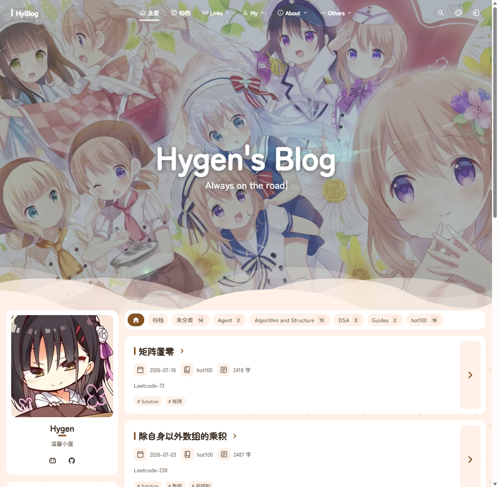
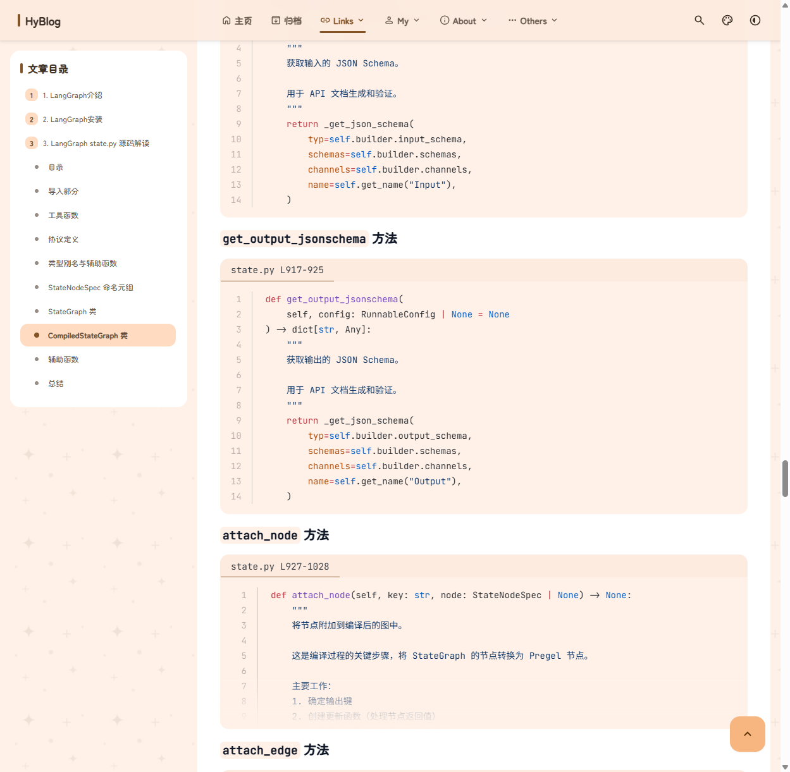
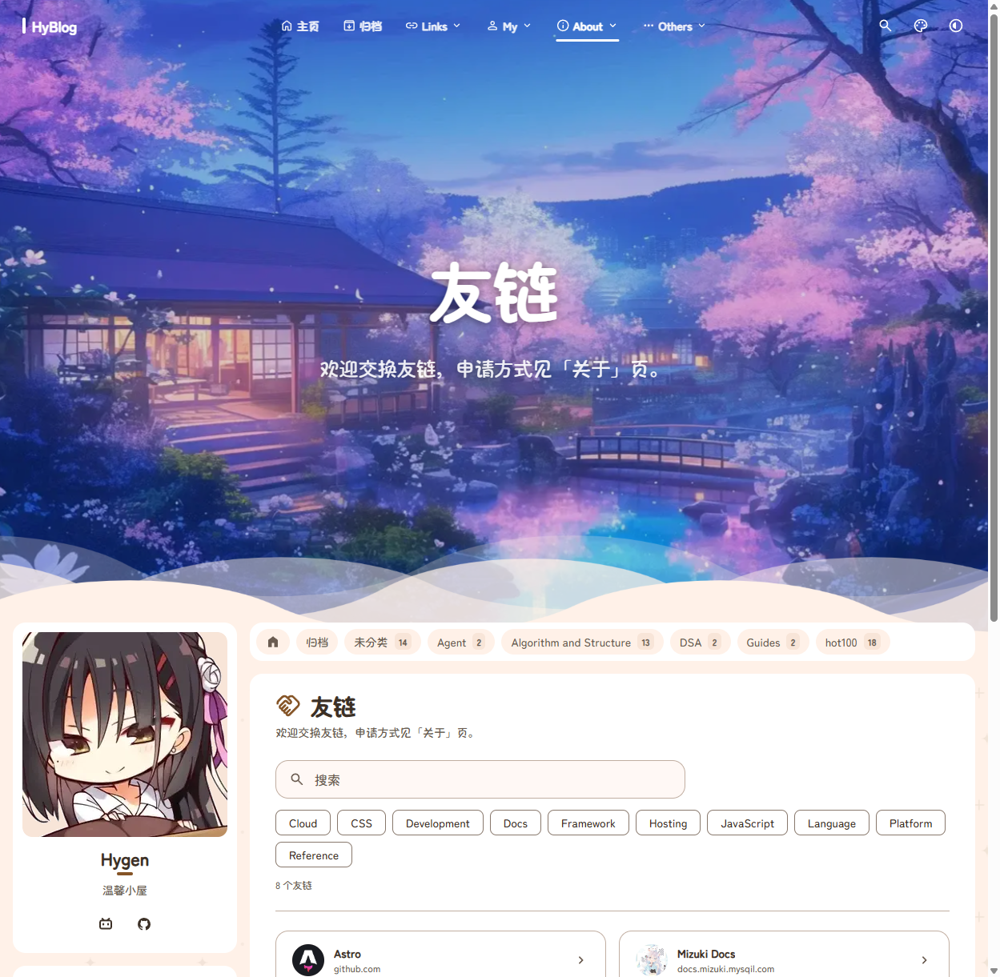
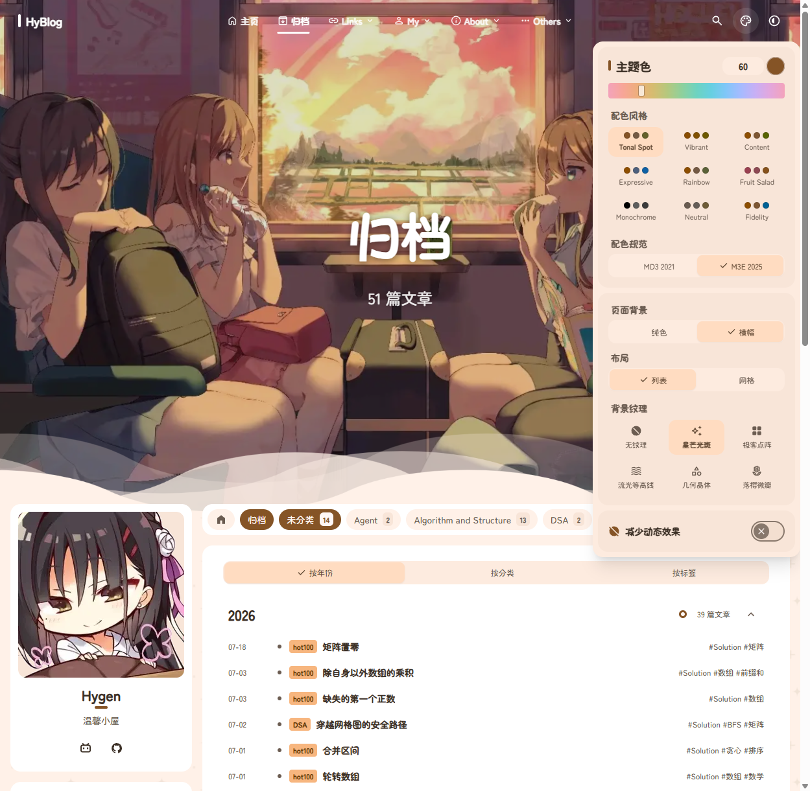
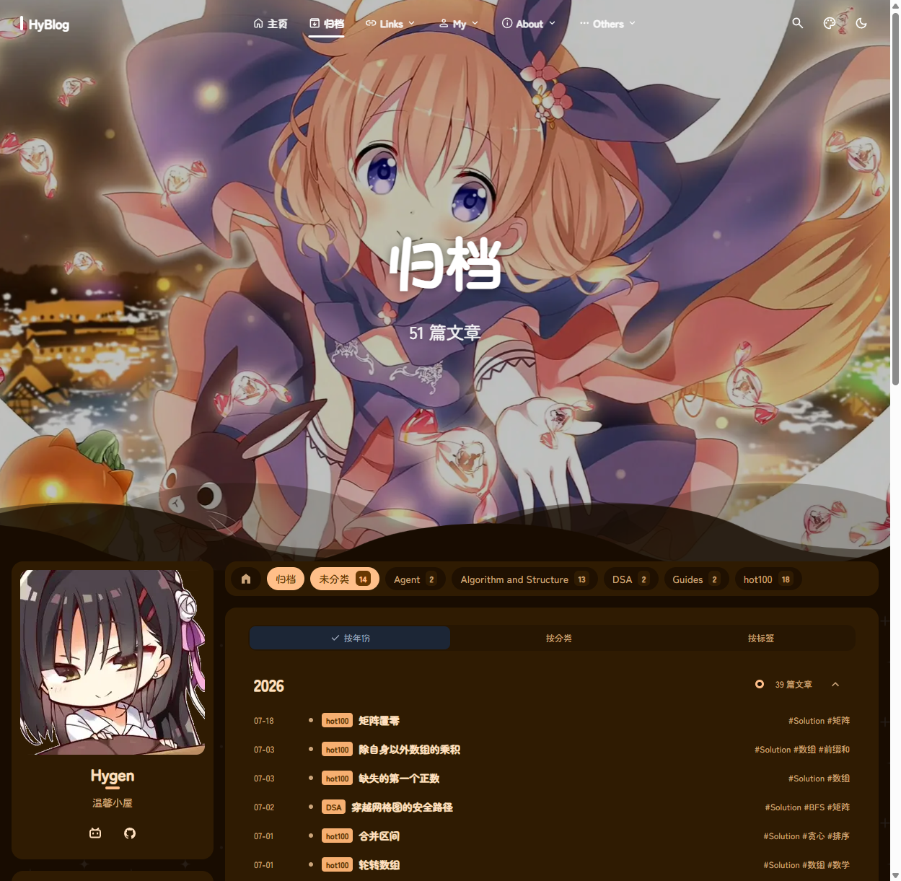

这次把博客的主题仓库合并到了upstream的`2.0.0`，合并提交是`060a69a`。合并完先过了`pnpm build`和`npx astro check`，两者都是0错误，剩下最后一步是起本地dev服务器做视觉验证，验证过程中还顺带排查了一个控制台的504报错，这里记录一下完整过程。

# 1. 启动与content:sync

进入主题仓库后直接启动：

```bash
cd E:\blog\Shirone
pnpm dev
```

`pnpm dev`会先跑`content:sync`，把内容仓库`Shirone-Content`里的文章和`config/*.yaml`物化进`src/content`和`src/config`的overlay，这次的输出是`Materialized 143 files, config overlays 28`。之后Astro就起在默认的`http://localhost:4321`。

# 2. 逐项验证

## 2.1 首页

banner、分类条、文章列表、左侧边栏（头像、公告、标签）都正常渲染，没有裸奔样式。



## 2.2 文章页代码块

重点验证的是`Agent/LangGraph/原理/002.底层源码解析`这篇，因为上一个commit `ef4211b`刚修过它里面的python fence标题。注意一点：文章的URL不是目录原名，content collection会把id slug化，`002.底层源码解析`对应的实际地址是`/posts/agent/langgraph/原理/002底层源码解析/`，路径里的`.`会被去掉，目录名也全部转小写。

打开后`state.py L917-925`这类`title="..."`的代码块正常渲染：顶部有文件名标题栏，内部是Python语法高亮加行号，左侧文章目录也会跟随滚动高亮。修复确认生效。



## 2.3 功能页

`/friends/`、`/about/`、`/albums/`、`/moments/`四个页面数据都正常：友链8条带标签筛选和搜索，关于页的自我介绍和GitHub卡片正常，相册1个，动态也有内容。



## 2.4 禁用页

`/games/`和`/compass/`按预期返回404，`games.yaml`里的`enable: false`是刻意配置，这里确认禁用生效。

## 2.5 Swup导航与主题切换

导航是Swup接管的客户端跳转：在`window`上放了一个标记再点"归档"，跳转后标记还在，说明没有整页刷新，无闪烁。

显示设置面板也能完整展开：主题色色相滑块、九种配色风格、M3E 2025规范、背景纹理和布局选项都在。把配色风格从Tonal Spot切到Expressive后，`--mc-primary`从`#855426`变成了`#8f4f00`，主题色系统工作正常。暗色模式也能整页切换。





# 3. 排查：dev-toolbar的504报错

## 3.1 现象

页面功能虽然都正常，但控制台一直挂着一条报错：

```text
GET /@id/astro/runtime/client/dev-toolbar/entrypoint.js
→ 504 (Outdated Optimize Dep)
```

## 3.2 排查过程

第一反应是vite的依赖预构建缓存脏了，因为dev server日志里能看到启动后有一次`Forced re-optimization of dependencies`，而且中途`@swup/astro/client/*`这批依赖被单独重新bundling过，之后浏览器就报了一堆旧`?v=`hash的504。

于是停掉dev server，删掉`node_modules/.vite`再重启。结果清缓存后依然复现，并且直接用`curl`请求这个entrypoint也是504，说明不是浏览器侧的旧hash残留，是服务端对这个模块的请求**稳定返回**504，属于确定性问题。

## 3.3 根因

顺着`504 Outdated Optimize Dep`去搜了astro的issue，确认这是**上游已知的回归bug**（[astro#17929](https://github.com/withastro/astro/issues/17929)、[#16630](https://github.com/withastro/astro/issues/16630)，修复PR是[#17931](https://github.com/withastro/astro/pull/17931)）。

原因是Astro在引入Vite Environment API重构时（PR #14306），把client环境的`optimizeDeps.entries`里的`.astro`给去掉了，注释写着"Astro files can't be rendered on the client"。这句话本身没错，但`.astro`文件里的`<script>`标签是会引用客户端依赖的，扫描器扫不到它们，这些依赖就只能在运行时才被Vite发现。

我们这个仓库里触发它的就是`@swup/astro/*`这批依赖——运行时才发现、重新打包、整轮re-optimize换一个`browserHash`，而已经发出去的模块（包括dev toolbar的entrypoint）还拿着旧hash，Vite对它们一律回504。

## 3.4 结论

这是Astro 7.x的上游bug，不是这次合并引入的问题。影响范围只有dev工具栏这一个overlay，页面本身和`pnpm build`的产物都不受影响，等PR #17931合并就会好。如果想立刻消掉报错，workaround有两个：在`astro.config.mjs`里设`devToolbar: { enabled: false }`，或者把`@swup/astro/client/*`加进`vite.optimizeDeps.include`。

# 4. CI确认

最后去Actions看了一眼，合并提交触发的`Shirone CI #12`已经跑绿（8m32s），同一个commit的`Deploy #22`也成功了。

# 5. 总结

- upstream `2.0.0`合并后，首页、文章页、四个功能页全部正常，之前修的fence标题栏确认生效
- `enable: false`的页面正确404，Swup导航和主题系统工作正常
- 唯一的控制台504是Astro上游bug，只影响dev toolbar，已有修复PR在途
- 两条已知噪声顺带记一下：有文章在数学模式里用了中文字符导致KaTeX `unicodeTextInMathMode`警告（内容侧的问题）；`/about/`的GitHub卡片请求`api.github.com`未认证接口被限流返回403，卡片有兜底渲染
